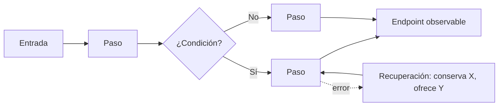

# Proceso estructural (Fase 1)

La Fase 1 decide qué hay en la pantalla, en qué orden, con qué estados y cómo se adapta, antes de cualquier decisión visual. Su salida es una estructura aprobada por el usuario. La dirección de arte posterior la interpreta; no la reescribe.

## 1. Brief funcional

El brief es la compuerta de entrada. Si no cabe en una página, la superficie está mal delimitada.

### Orden de trabajo

1. **Leer el contexto disponible:** código (rutas, estados, props, permisos), documentación del producto, steering del proyecto y conversación previa de esta ronda. Anotar la fuente de cada hecho.
2. **Separar** lo que se sabe (hechos), lo que se asume para avanzar (supuestos declarados) y lo que falta (incógnitas).
3. **Preguntar** solo las incógnitas que cambian la arquitectura de información: entre 2 y 6 preguntas, en un único mensaje y sin preguntas estéticas.

### Campos

| Campo | Buena forma | Mala forma |
|---|---|---|
| Persona y situación | «La recepcionista confirma la llegada de un paciente mientras atiende el teléfono» | «Usuarios» |
| Enunciado | «Necesita confirmar llegadas porque la sala se satura» | «Pantalla de pacientes» |
| Pregunta de diseño | «¿La lista permite distinguir en 2 s quién ya llegó?» | «¿Se ve bien?» |
| Verbo principal | registrar, comparar, aprobar, reprogramar | gestionar, administrar, manejar |
| Resultado verificable | «La cita cambia a *En sala* y aparece en la cola» | «El usuario queda satisfecho» |
| Dato dominante | El que se mira primero y decide la acción | Todos los campos de la API |
| Intención emocional | «Calma bajo presión: nada compite con la próxima acción» | «Moderno y limpio» |
| Criterios de aceptación | Observables: qué se ve, qué cambia, en cuánto tiempo | Opiniones |

La intención emocional alimenta la Fase 2 (material). Si el brief no la tiene, pregúntala junto con las incógnitas estructurales; es la única pregunta no funcional permitida en esta fase.

### Riesgo por acción

| Tipo | Ejemplo | Confirmación |
|---|---|---|
| Reversible | Filtrar, ordenar, guardar favorito | Ninguna; feedback breve |
| Con deshacer | Archivar, marcar como leído | Aviso con **Deshacer** visible al menos 5 s |
| Destructiva | Eliminar, cancelar con cobro | Diálogo que nombra la consecuencia y usa el verbo del resultado («Cancelar cita») |

### Continuidad

Para cada superficie declara: conexión lenta (skeleton con la misma huella), sin conexión (qué se ve, qué se encola, qué se bloquea), error (mensaje y reintento sin perder lo capturado), sesión reanudada (a dónde vuelve) y cambio de tamaño u orientación (qué estado y foco se conservan).

### Antipatrones del brief

- Inventar campos para «llenar» un layout.
- Mezclar preguntas funcionales con estéticas.
- Describir la UI («un grid de tarjetas») en lugar de la tarea.
- Omitir incógnitas para parecer completo.

## 2. Flujo de usuario

Un flujo por **objetivo del usuario**, no por pantalla. Se dibuja antes de las pantallas cuando hay más de una o la funcionalidad es nueva.

Elementos obligatorios:

1. **Entrada:** desde dónde llega (enlace, notificación, búsqueda, deep link, sesión reanudada).
2. **Pasos significativos:** solo los que cambian lo que el usuario sabe o decide.
3. **Decisiones:** condiciones del sistema o elecciones del usuario; las condicionales se marcan («solo si hay 2 o más colaboradores»).
4. **Rutas de error y recuperación:** qué falla, qué se conserva, cómo se vuelve.
5. **Endpoint observable:** evidencia concreta de que terminó.

Revisión: ¿cada paso tiene una sola intención? ¿Hay pasos que solo existen por la implementación? ¿Se puede volver desde cada paso sin perder datos? ¿El flujo sobrevive a una sesión reanudada y a un cambio de tamaño?

## 3. Elegir fidelidad

La fidelidad es una herramienta para responder una pregunta, no un nivel que haya que desbloquear. Elige la menor fidelidad que responda la pregunta de diseño del brief.

| Si la incertidumbre está en | Usa | Porque |
|---|---|---|
| Qué pasos y decisiones hay | Flujo | Cambiar una flecha es gratis |
| Qué va en la pantalla y en qué orden | Wireframe de baja fidelidad | Compara estructuras sin debatir color |
| Si el contenido real rompe la jerarquía, cómo se ven los estados, cómo se recompone en móvil | Wireframe de fidelidad media | Contenido y estados sin coste de acabado |
| Percepción, confianza, marca, microinteracción, motion | Alta fidelidad (Fases 2 a 4) | La pregunta depende del realismo |

Se puede saltar directamente a la dirección de arte cuando la estructura no está en discusión: el usuario la entregó cerrada o existe una referencia aprobada. Regístrala como estructura aprobada.

**Error capital:** usar un mockup impecable para vender una estructura mala. El acabado da una falsa sensación de completitud; por eso las alternativas A/B/C son neutras.

## 4. Tres alternativas estructurales

Presenta exactamente tres propuestas, A, B y C. Una comparación parcial o una propuesta única no cierra la fase.

### Qué las hace distintas

Cada alternativa cambia al menos uno de estos ejes respecto a las otras dos:

- **Estructura:** qué zonas existen y cómo se relacionan (lista-detalle, panel único, flujo por pasos).
- **Jerarquía:** qué dato o acción domina.
- **Densidad:** cuánta información se ve sin interacción.
- **Interacción:** cómo se llega a la acción principal (directa, progresiva, por selección).

Tres variaciones de espaciado sobre el mismo esqueleto no son tres alternativas.

### Contenido de cada alternativa

1. Nombre corto y la idea en una frase.
2. Qué problema del brief prioriza y qué sacrifica.
3. Zonas: navegación global, encabezado de contexto, contenido principal, acciones contextuales, feedback temporal.
4. Jerarquía de contenido: N1 (se ve primero y decide), N2 (contexto necesario), N3 (consulta), bajo demanda y fuera de esta pantalla.
5. Jerarquía de acciones: una sola primaria por vista, secundarias, terciarias y destructivas separadas.
6. Orden de lectura y orden de foco.
7. Estados (ver `states-and-validation.md`).
8. Matriz de adaptación (sección 5).
9. Supuestos y trade-offs.

### Tratamiento neutro

Grises, una familia tipográfica, jerarquía por tamaño y espacio. Sin paleta de marca, sin sombras decorativas, sin motion. La jerarquía debe funcionar sin color. No introduzcas una tarjeta solo porque las librerías tienen tarjetas: usa una superficie solo si comunica un grupo independiente, un límite de interacción o un objeto seleccionable.

### Preguntas por pantalla

Cada pantalla responde por escrito: ¿qué necesita **saber** la persona aquí?, ¿qué necesita **hacer**?, ¿qué **acción domina**?, ¿qué **resultado** produce y a dónde lleva?

### Compuerta de aprobación

Presenta las tres con una recomendación razonada y espera la elección del usuario. Si rechaza las tres, abre otra ronda con tres alternativas nuevas que respondan a sus objeciones. No pases a la Fase 2 sin estructura aprobada.

## 5. Geometría y adaptación

### Matriz de adaptación

Describe siempre compact (< 600 px), medium (600–1023 px) y expanded (≥ 1024 px):

| Aspecto | compact | medium | expanded |
|---|---|---|---|
| Qué se conserva | | | |
| Qué cambia de estructura | | | |
| Qué se oculta o se divulga bajo demanda | | | |
| Forma de la navegación | | | |
| Posición de la acción primaria | | | |
| Relación lista-detalle | | | |

No escales el mismo layout. Al contraer el ancho conserva este orden: 1) estado o alerta que requiere atención, 2) tarea primaria, 3) información para ejecutarla, 4) contexto, tendencia e historial, 5) acciones raras o administrativas.

No escondas datos operativos porque «no caben»: cambia su representación (resumen y detalle, acordeón, vista dedicada). Las tablas anchas se vuelven tarjetas resumidas o columnas prioritarias, nunca texto microscópico. En móvil, los elementos fijos respetan la zona segura inferior y no tapan la última fila ni la acción primaria; con el teclado abierto, el campo activo y su error siguen visibles.

### Geometría por región

Para cada región principal registra: rol y dato dominante, tamaño de referencia cuando afecta a la usabilidad, posición en el grid, relación de espaciado con las regiones vecinas, densidad y rango de contenido esperado, tamaño de los targets interactivos y comportamiento ante desbordamiento, truncado o salto de línea.

Una dimensión sin origen no es una dimensión: indica de dónde sale (rango de contenido, target de 44 px, uso con una mano). Prueba cada pieza con el contenido más largo de su rango; si no cabe, cambia la estructura en lugar de solo truncar.

### Navegación

| Destino | Patrón |
|---|---|
| 3–5 áreas principales frecuentes | Barra inferior en móvil, navegación lateral en escritorio |
| Colección o historial | Lista con búsqueda y filtros |
| Objeto individual | Ruta con título persistente y acción contextual |
| Trabajo breve y focalizado | Modal u hoja inferior |
| Configuración poco frecuente | Ajustes, fuera de la navegación principal |

Entre tamaños cambia el contenedor de la navegación, no la arquitectura. **Volver** regresa al contexto anterior conservando filtros y posición; **Cancelar** abandona trabajo sin guardar y avisa qué se pierde; **Cerrar** descarta una capa temporal.

### Procedencia de decisiones

Las decisiones estructurales importantes usan un registro compacto: elección, fuente (regla, contexto del producto o inferencia), motivo, alternativas descartadas, modos afectados y estado (propuesta, aprobada o sin resolver). Nunca atribuyas una inferencia a un estándar.

## 6. Aislamiento de rondas

Cada brief nuevo inicia una ronda nueva.

- Los diseños, capturas y decisiones de rondas o conversaciones anteriores son historia: no alimentan las alternativas actuales.
- Un tema parecido no autoriza reutilización.
- Solo si el usuario nombra un artefacto concreto y pide reutilizarlo, refinarlo, extenderlo o compararlo, se toma ese artefacto como punto de partida, declarando qué cambia.
- La entrega declara la ronda, las entradas activas y, si la hubo, la continuidad autorizada.

## 7. Copy funcional

En fidelidad media las palabras ya son diseño:

- Nombra las cosas como las entiende el usuario, no como está construido el sistema.
- El botón dice exactamente qué pasa: «Guardar temperatura», no «Enviar». La misma acción conserva su nombre en todo el flujo.
- Los errores siguen la fórmula **qué pasó + qué significa + siguiente acción**: «No se pudieron sincronizar 2 mediciones. Se mantienen en este dispositivo. Reintentar».
- Un vacío es una invitación a actuar: explica qué aparecerá y ofrece la primera acción.
- Etiqueta visible en cada campo; el placeholder no es etiqueta.
- Unidad pegada al número (`38.5 °C`) y precisión con significado.

## 8. ¿Cuándo está lista la estructura?

- [ ] Están las pantallas esenciales y ninguna sin propósito.
- [ ] Se contemplan todos los estados del brief.
- [ ] El flujo principal se recorre; entradas, salidas y decisiones tienen continuidad.
- [ ] Navegación clara, información priorizada y una sola acción primaria por vista.
- [ ] Nada depende solo del color o de un icono para comunicar estado.
- [ ] Cada pantalla responde las cuatro preguntas.
- [ ] La matriz de adaptación está completa para los tres modos.
- [ ] Hay tres alternativas realmente distintas y el usuario aprobó una.
