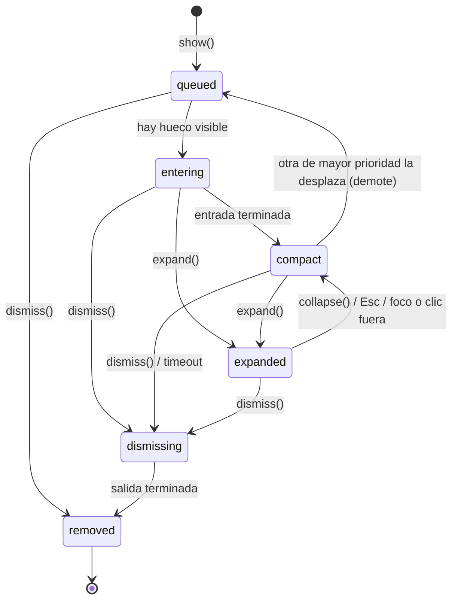

# Brief funcional · Isla (superficie de actividad superior) · r01

**Ruta:** R1 · **Fidelidad:** F2. Se eligió F2 porque lo que hay que decidir son estados, interacción, interrupciones y comportamiento responsive, no la apariencia. **Fecha:** 2026-10-26
**Fuentes leídas:** `agentes/kiwi/AGENT.md`; `references/{brief-funcional,fidelidad,wireframing,geometry-contract,hig-web-pwa,validacion}.md`; plantillas `brief/declaracion/hallazgos`; perfil `mis-agentes/skills/lima/profiles/isla-nombre-pendiente.md`; `docs/01-investigacion-y-diferenciacion.md`; las decisiones que aprobó el usuario en la conversación.

## Enunciado
Un **equipo de desarrollo web** necesita **mostrar el estado de tareas y avisos breves sin interrumpir al usuario final**, porque los toasts actuales se crean y destruyen por evento (no se pueden actualizar), apilan ruido y gestionan mal la accesibilidad del contenido que cambia.

## Pregunta de diseño
¿Una única superficie no modal en el borde superior, que alterna entre compacta y expandida y se actualiza sin recrearse, puede comunicar progreso, resultado y acciones sin tapar ni bloquear la página y siendo accesible por teclado y lector de pantalla?

- **Verbo principal:** *informar del estado de una actividad* (y ofrecer como mucho 2 acciones contextuales).
- **Resultado verificable:** el usuario percibe el cambio de estado (visual + anuncio), puede actuar o ignorarlo, y la página sigue operativa (foco, clics y scroll intactos).
- **Dato/acción dominante:** el título de la actividad y su valor (porcentaje, tiempo o resultado).

## Usuarios y permisos
| Usuario | Necesita | Permiso |
|---|---|---|
| Desarrollador integrador | API imperativa pequeña, tokens CSS, sin framework | — |
| Usuario final con ratón o táctil | Ver, expandir, actuar, cerrar | — |
| Usuario de teclado | Llegar a la isla, expandir/contraer, Esc, volver | — |
| Usuario de lector de pantalla | Anuncios sin saturación; controles con nombre | — |
| Usuario con `prefers-reduced-motion` | Sin desplazamientos ni escalados | — |

## Estados (de la actividad)
`queued` · `entering` · `compact` · `expanded` · `updating` (transitorio, no es una fase) · `dismissing` · `removed`. Además, el flag `persistent`.
Contenido: aviso · progreso determinado/indeterminado · temporizador · multimedia · deshacer · error · contenido largo · varias simultáneas.

## Flujo anterior / posterior
La página dispara `show()` → la actividad se encola → pasa a visible (entering → compact) → `update()` n veces → `expand/collapse` a demanda → `dismiss()` (por usuario, acción, tiempo agotado o código) → removed. Si el foco estaba dentro al descartar, vuelve al disparador; si este ya no existe, a `main`.

## Riesgo por acción
| Acción | Tipo | Confirmación |
|---|---|---|
| Cerrar actividad | Reversible (el consumidor puede volver a mostrarla) | Ninguna |
| Acción contextual (p. ej. «Deshacer») | La define el consumidor | Fuera del MVP; si es destructiva, la tiene que confirmar el consumidor (no hay `confirm` en el MVP) |
| Autodescartar por tiempo | Reversible | Se pausa con hover, foco, expandido y pestaña oculta (WCAG 2.2.1) |

## Continuidad
| Situación | Comportamiento |
|---|---|
| Conexión lenta | Responsabilidad del consumidor; la isla muestra progreso indeterminado si se lo indica |
| Sin conexión | Caso de uso: actividad `persistent` con prioridad alta |
| Error | `intent:'error'`: único caso con `role=alert`; persistente por defecto |
| Sesión reanudada | Fuera del MVP: no hay persistencia entre recargas |
| Cambio de tamaño | Se recalcula el ancho; no hay estado ligado al breakpoint |
| Pestaña oculta | Los timers se pausan |

## Alcance MoSCoW
- **Must:** compacto/expandido; `update` sin recrear; cola por prioridad (1 primaria + 1 secundaria + contador); anuncios limitados; teclado completo; movimiento reducido; safe-area; animaciones interrumpibles; limpieza total de recursos.
- **Should:** temporizador (`role=timer`); progreso indeterminado; `promise()` como azúcar sobre la API.
- **Could:** gestos (deslizar para cerrar), adaptador Web Component, atajo global opcional.
- **Won't (MVP):** `confirm`/`<dialog>`, persistencia entre recargas, HTML como string, temas prediseñados.

## Hechos · Supuestos · Incógnitas
**Hechos:** decisiones 1–5 aprobadas por el usuario (ver perfil); compatibilidad de APIs según `@mdn/browser-compat-data` 8.1.7 (docs/02).
**Supuestos (declarados):** máximo 2 acciones por actividad; ancho máximo 400 px (propuesto, ver D-04); umbral de anuncios de 1 s.
**Incógnitas:** ver D-07…D-12 en `decisiones.yaml`.

## Flujo (F0)

`update()` se admite en queued, entering, compact y expanded sin cambiar de fase. En dismissing se ignora.
